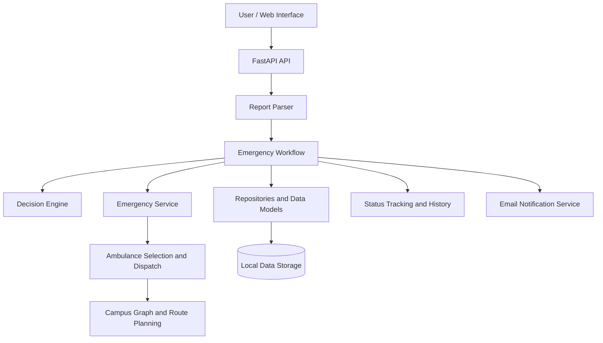

# ResQAI — Intelligent Emergency Response Agent

**An AI-assisted emergency reporting, prioritization, ambulance selection, and campus route-planning system.**

ResQAI is a student software project designed to support emergency response within a campus environment. It accepts emergency reports, processes incident information, helps prioritize emergencies, and supports ambulance selection and route planning using a campus map.

The project combines backend engineering, agent-based decision-making, graph algorithms, API development, and incident management in one system.

> **Disclaimer:** ResQAI is an educational project, not an official emergency dispatch service. Its outputs do not guarantee that an ambulance is available, assigned, or dispatched. Do not rely on this project as a substitute for real emergency services.

## Table of Contents

- [Project Overview](#project-overview)
- [Features](#features)
- [Technology Stack](#technology-stack)
- [System Architecture](#system-architecture)
- [Project Structure](#project-structure)
- [Prerequisites](#prerequisites)
- [Installation](#installation)
- [Configuration](#configuration)
- [Running the Application](#running-the-application)
- [API Documentation](#api-documentation)
- [Running Tests](#running-tests)
- [Data and Persistence](#data-and-persistence)
- [AI and Algorithms](#ai-and-algorithms)
- [Limitations](#limitations)
- [Future Improvements](#future-improvements)
- [Author](#author)

## Project Overview

During an emergency, responders need clear incident information, sensible prioritization, and an efficient route to the reported location. ResQAI explores how software agents and graph-search algorithms can assist with these tasks in a campus environment.

The backend is built with Python and FastAPI. A React-based web interface provides a way to interact with the system.

The project is organized into separate modules for decision-making, report parsing, routing, ambulance handling, emergency workflows, data models, and persistence.

## Features

- **Emergency reporting:** Submit emergency information through the API and application.
- **Report interpretation:** Process natural-language emergency descriptions using the project's report parser.
- **Emergency prioritization:** Apply the decision engine to support emergency-response decisions.
- **Campus route planning:** Represent campus locations and connections as a graph and provide routing algorithms.
- **Ambulance selection:** Evaluate available ambulance information and support vehicle-selection and dispatch workflows.
- **Incident management:** Store and retrieve emergency reports and manage incident status transitions.
- **Status history:** Maintain a history of incident-status changes.
- **Campus directory:** Retrieve campus locations and facilities.
- **Additional ambulance requests:** Submit requests for additional ambulances.
- **Email notifications:** Support email notifications when the required configuration is available.
- **REST API:** Expose backend functionality through FastAPI endpoints.
- **Automated tests:** Include tests for report parsing, decision-making, routing, repositories, workflows, and API behavior.

The actual behavior of individual features depends on the implementation and runtime configuration. Email delivery, for example, depends on valid SMTP settings.

## Technology Stack

| Technology | Purpose |
|---|---|
| Python 3.10+ | Backend programming language |
| FastAPI | REST API development |
| Pydantic | Data validation and models |
| Uvicorn | ASGI application server |
| React | Web interface |
| Vite | Frontend development server and build tooling |
| pytest | Automated testing |
| SQLite and JSON | Local data storage used by the project |
| A* and Dijkstra | Graph-search algorithms available in the routing module |

## System Architecture



The diagram illustrates the major architectural components. The exact execution path depends on how the modules are connected in the source code.

## Project Structure

```text
intelligent-emergency-response-agent/
├── data/
│   ├── campus_map.json
│   ├── sample_ambulances.json
│   ├── ambulance_requests.json
│   ├── campus.db
│   ├── emergency_reports.json
│   └── status_history.json
├── frontend/
│   ├── package.json
│   └── src/
├── src/
│   └── emergency_response/
│       ├── agents/
│       │   └── decision_engine.py
│       ├── ai/
│       │   └── report_parser.py
│       ├── database/
│       │   ├── campus_repository.py
│       │   ├── emergency_repository.py
│       │   ├── repository.py
│       │   └── status_history_repository.py
│       ├── models/
│       │   ├── ambulance.py
│       │   ├── emergency.py
│       │   ├── location.py
│       │   └── status_history.py
│       ├── routing/
│       │   ├── astar.py
│       │   ├── dijkstra.py
│       │   └── graph.py
│       ├── services/
│       │   ├── ambulance_request_service.py
│       │   ├── ambulance_service.py
│       │   ├── dispatch_service.py
│       │   ├── email_notifier.py
│       │   ├── emergency_service.py
│       │   ├── emergency_status_service.py
│       │   └── emergency_workflow.py
│       ├── api.py
│       └── main.py
├── tests/
├── .env.example
├── .gitignore
├── pyproject.toml
├── requirements.txt
└── README.md
```

**Key backend modules**

- `api.py` — defines the HTTP API.
- `agents/decision_engine.py` — decision-making logic.
- `ai/report_parser.py` — emergency-report parsing.
- `routing/astar.py` — A* route-search implementation.
- `routing/dijkstra.py` — Dijkstra route-search implementation.
- `routing/graph.py` — graph representation and routing support.
- `services/emergency_workflow.py` — coordinates emergency processing.
- `services/dispatch_service.py` — dispatch and vehicle-selection logic.
- `database/` — data-access and repository modules.
- `models/` — data structures and validation models.

## Prerequisites

Install the following before running the project:

- **Python 3.10 or newer**
- **Node.js and npm** for the frontend
- **Git** to clone the repository
- A terminal such as Windows Command Prompt or the VS Code terminal

Check your installations:

```bash
python --version
node --version
npm --version
git --version
```

## Installation

### 1. Clone the repository

```bash
git clone https://github.com/ShashwatSingh321/intelligent-emergency-response-agent.git
cd intelligent-emergency-response-agent
```

### 2. Create and activate a Python virtual environment

On Windows Command Prompt:

```cmd
py -3.10 -m venv .venv
.venv\Scripts\activate
```

If Python 3.10 is not installed, use an installed Python version that satisfies the project's `requires-python` setting.

### 3. Install the backend

Upgrade pip and install the project in editable mode:

```cmd
python -m pip install --upgrade pip
pip install -e .
```

The project's `pyproject.toml` and `requirements.txt` define its Python package dependencies.

### 4. Install the frontend dependencies

Open a second terminal:

```cmd
cd frontend
npm install
```

Keep the backend and frontend terminals separate when running the application.

## Configuration

Copy the example environment file to create your local configuration:

```cmd
copy .env.example .env
```

The `.env` file is intended for local settings and credentials. **Never commit your real `.env` file or publish email passwords, API keys, or other secrets.**

If email notifications are required, configure the SMTP settings expected by the notification service in `.env`. Use credentials for an email account you control, and consult your email provider's documentation for the correct SMTP host, port, and authentication requirements.

Email functionality may remain unavailable until the required settings are supplied.

## Running the Application

### Start the backend

From the project root, with the virtual environment activated:

```cmd
python -m uvicorn emergency_response.api:app --reload --app-dir src
```

The backend should be available at:

- API base: `http://127.0.0.1:8000`
- Interactive Swagger documentation: `http://127.0.0.1:8000/docs`
- Alternative API documentation: `http://127.0.0.1:8000/redoc`

Keep this terminal open while using the application.

### Start the frontend

In a second terminal:

```cmd
cd frontend
npm run dev
```

Open the local URL printed by Vite in the terminal, typically:

`http://localhost:5173/`

If the frontend cannot reach the backend, check that the backend is running and that the frontend's API/proxy configuration points to the correct address.

## API Documentation

FastAPI generates interactive API documentation automatically. Open `http://127.0.0.1:8000/docs` after starting the backend to inspect the available endpoints, request schemas, response formats, and error responses.

The backend includes endpoint groups for emergency reports, campus locations and facilities, incident status and history, and additional ambulance requests.

Use the interactive documentation to test the exact request bodies supported by the running version. This is more reliable than relying on example payloads that might not match the current validation models.

## Running Tests

From the project root, activate the virtual environment and run:

```cmd
pytest -q
```

To run a particular test module:

```cmd
pytest tests/test_routing.py -v
pytest tests/test_decision_engine.py -v
pytest tests/test_report_parser.py -v
pytest tests/test_emergency_workflow.py -v
pytest tests/test_api.py -v
```

Tests help verify expected behavior in the routing algorithms, report parser, decision engine, emergency-processing workflow, persistence layer, and API.

A passing test suite does not by itself establish that the system is suitable for real-world emergency dispatch.

## Data and Persistence

The `data/` directory contains the campus map, sample ambulance data, and local persistence files used by different parts of the application.

- `campus_map.json` — campus map data.
- `sample_ambulances.json` — sample ambulance records.
- `ambulance_requests.json` — additional ambulance-request records.
- `campus.db` — SQLite database file.
- `emergency_reports.json` and `status_history.json` — local incident-related data files.

Some files may be created or updated while the application runs. Back up any records you need before resetting or replacing local data.

The project is designed for local development and demonstration. Production deployment would require a more robust operational data strategy, authentication, authorization, backups, and monitoring.

## AI and Algorithms

### Agent-based decision-making

The project includes a decision-engine module for making emergency-response decisions. Its specific rules, inputs, and outputs are defined by the implementation in `agents/decision_engine.py`.

### Emergency-report parsing

The report parser processes emergency descriptions. A parser that interprets text is not automatically a large language model; the actual technique should be identified from its implementation.

### A* pathfinding

A* is a graph-search algorithm commonly used to find a low-cost path between a starting node and a destination.

It evaluates nodes using:

\[
f(n) = g(n) + h(n)
\]

Where:

- \(g(n)\) is the cost from the starting node to node \(n\).
- \(h(n)\) is the estimated remaining cost from node \(n\) to the destination.
- \(f(n)\) is the estimated total path cost through node \(n\).

The quality of the result depends on the graph, edge costs, and heuristic. The existence of an A* module does not by itself mean the application uses live traffic or real-world road conditions.

### Dijkstra's algorithm

Dijkstra's algorithm finds shortest paths in graphs with non-negative edge weights. The project also contains a Dijkstra module; its relationship to the active dispatch workflow can be checked in the source code.

## Limitations

- The project is an educational prototype, not a certified emergency-response system.
- Campus routing depends on the accuracy and completeness of the supplied map.
- Route calculations do not imply live traffic awareness unless a live data integration is implemented.
- Ambulance selection depends on the available records and implemented selection logic.
- Email configuration and successful email delivery are separate concerns.
- A submitted ambulance request does not confirm that a real ambulance has been assigned or dispatched.
- The project should not be used for real emergency decisions without appropriate validation, operational integration, security, and human oversight.

## Future Improvements

Potential areas for further development include:

- Integration with a validated language model for more flexible report interpretation.
- Dynamic updates to campus paths and route costs.
- More rigorous utility-based decision-making and explainable priority scoring.
- Integration with authenticated, real-time ambulance availability systems.
- Improved observability, audit logging, and deployment configuration.
- Expanded integration and end-to-end testing.

These are potential improvements, not claims that all such capabilities are currently implemented.

## Author

**Shashwat Singh**

GitHub: [@ShashwatSingh321](https://github.com/ShashwatSingh321)

Repository: [Intelligent Emergency Response Agent](https://github.com/ShashwatSingh321/intelligent-emergency-response-agent)

---

If you find this project useful for learning about emergency-response software, agent-based decision-making, or graph algorithms, feel free to explore the code and tests.
